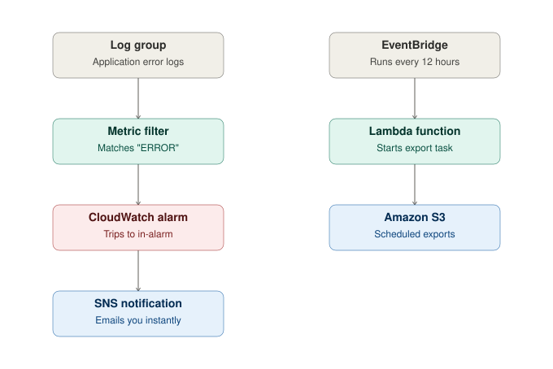

# CloudWatch Error Monitoring & Automated S3 Export Pipeline

A serverless AWS pipeline that detects application errors in CloudWatch Logs, alerts an engineer in real time via email, and automatically archives logs to S3 on a recurring schedule.

## What it does

1. An application writes logs to a CloudWatch Logs log group.
2. A metric filter scans incoming log lines for the string `ERROR` and increments a custom CloudWatch metric.
3. A CloudWatch alarm watches that metric and trips to `ALARM` state as soon as a single matching error is logged.
4. The alarm publishes to an SNS topic, which emails the on-call engineer immediately.
5. Independently, a scheduled AWS Lambda function (triggered by EventBridge every 12 hours) calls the CloudWatch Logs export API to archive the last 24 hours of logs into an S3 bucket, so nothing is lost even outside of alarm events.

## Architecture

Two independent paths share the same log group as their source:

- **Real-time alerting path:** Log group → Metric filter → CloudWatch alarm → SNS → Email
- **Scheduled archival path:** EventBridge (every 12h) → Lambda → CloudWatch Logs export task → S3

## Why this design

- **Real-time alerting and archival are decoupled.** The alarm/notification path reacts instantly to a single error. The export path runs independently on a timer, so a quiet period with no alarms doesn't mean logs stop getting archived, and a burst of alarms doesn't put extra load on the export mechanism.
- **24-hour lookback on every export run, scheduled every 12 hours.** This creates deliberate overlap between runs. If one scheduled run is delayed or fails, the next run still captures everything, at the cost of some duplicate objects in S3 (cheap to store, easy to dedupe if ever needed).
- **IAM permissions are scoped tightly.** The Lambda's execution role only grants `logs:CreateExportTask`, `logs:DescribeExportTasks`, `logs:DescribeLogGroups`, and permission to write its own execution logs — nothing broader.

## Components

| Component | Purpose |
|---|---|
| CloudWatch Logs log group | Source of truth for application logs |
| Metric filter (`CriticalErrorCount`) | Pattern-matches `ERROR` in log lines, emits `AppErrorEvents` metric |
| CloudWatch alarm (`Sandbox-Application-Error-Alarm`) | Trips to `ALARM` when `AppErrorEvents >= 1` within 1 minute |
| SNS topic | Delivers email notification on alarm state change |
| Lambda (`ExportLogsToS3`) | Triggers a CloudWatch Logs export task on a schedule |
| EventBridge rule | Invokes the Lambda every 12 hours |
| S3 bucket | Stores exported log archives under `scheduled-exports/` |

## Setup

Prerequisites:
- An AWS account with permissions to create CloudWatch Logs, IAM roles, Lambda functions, EventBridge rules, S3 buckets, and SNS topics
- The AWS CLI configured locally

Steps are documented in [`docs/architecture.md`](docs/architecture.md).

## Notable debugging story

While setting this up, log exports to S3 failed repeatedly with a vague AWS error message. The root cause turned out to be a region mismatch between the log group and the destination bucket — not a bucket policy or IAM issue, despite the error message pointing that direction. Full writeup, including the CloudTrail evidence that cracked it, is in [`docs/troubleshooting.md`](docs/troubleshooting.md).

## Files in this repo

- `policies/s3-bucket-policy.json` — the S3 bucket policy granting CloudWatch Logs export permissions
- `lambda/export_logs_to_s3.py` — the scheduled export Lambda function
- `docs/architecture.md` — full component breakdown and setup steps
- `docs/troubleshooting.md` — the region-mismatch debugging postmortem
- `docs/screenshots/` — supporting screenshots (sanitized)

## Disclaimer

Account IDs, bucket names, and any account-specific values in this repo have been replaced with placeholders. This was built as a sandbox/learning project.
