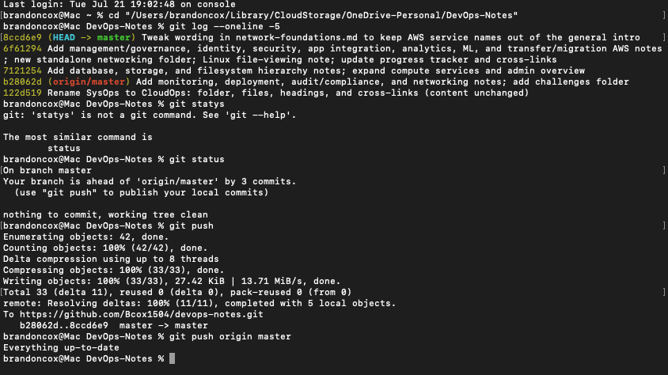

# Git Commit/Push Troubleshooting

Notes from getting this project's local commits pushed up to GitHub for the first time.



## What happened

Checked in on the repo after having made some local commits and wasn't sure if they'd actually made it to GitHub yet.

```
$ git log --oneline -5
8ccd6e9 (HEAD -> master) Tweak wording in network-foundations.md to keep AWS service names out of the general intro
6f61294 Add management/governance, identity, security, app integration, analytics, ML, and transfer/migration AWS notes; new standalone networking folder; Linux file-viewing note; update progress tracker and cross-links
7121254 Add database, storage, and filesystem hierarchy notes; expand compute services and admin overview
b28062d (origin/master) Add monitoring, deployment, audit/compliance, and networking notes; add challenges folder
122d519 Rename SysOps to CloudOps: folder, files, headings, and cross-links (content unchanged)
```

The `(origin/master)` tag sitting on `b28062d` while `HEAD -> master` was three commits ahead on `8ccd6e9` was the tell — local was ahead of what GitHub had.

Typo'd the status check first:

```
$ git statys
git: 'statys' is not a git command. See 'git --help'.

The most similar command is
        status
```

Git's own suggestion pointed to the right command. Ran it properly:

```
$ git status
On branch master
Your branch is ahead of 'origin/master' by 3 commits.
  (use "git push" to publish your local commits)

nothing to commit, working tree clean
```

Confirmed: 3 local commits not yet pushed, nothing uncommitted. Pushed:

```
$ git push
Enumerating objects: 42, done.
Counting objects: 100% (42/42), done.
Delta compression using up to 8 threads
Compressing objects: 100% (33/33), done.
Writing objects: 100% (33/33), 27.42 KiB | 13.71 MiB/s, done.
Total 33 (delta 11), reused 0 (delta 0), pack-reused 0 (from 0)
remote: Resolving deltas: 100% (11/11), completed with 5 local objects.
To https://github.com/Bcox1504/devops-notes.git
   b28062d..8ccd6e9  master -> master
```

Double-checked with an explicit push to be sure:

```
$ git push origin master
Everything up-to-date
```

## Takeaway

`git status` telling you you're "ahead of origin by N commits" means those commits exist locally but GitHub doesn't have them yet — `git push` is what actually publishes them. Committing alone never touches the remote. Worth checking `git status` before assuming a commit is "done."
